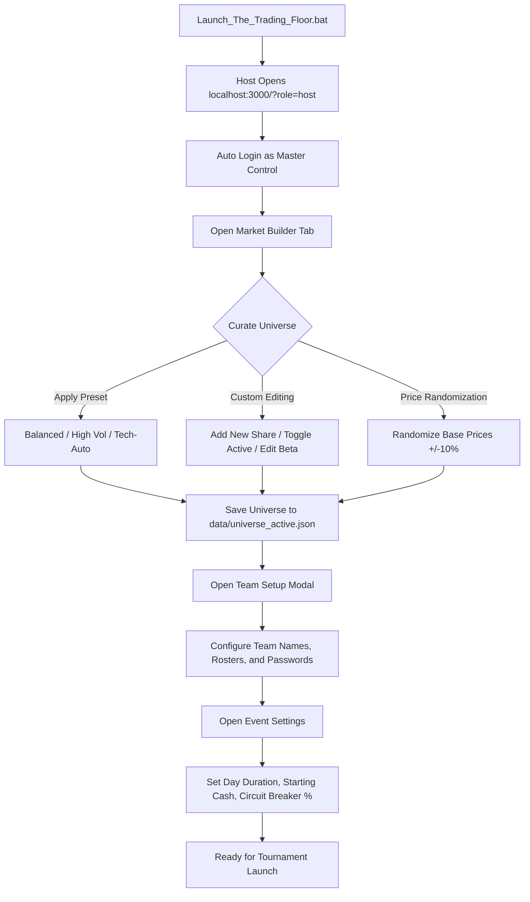
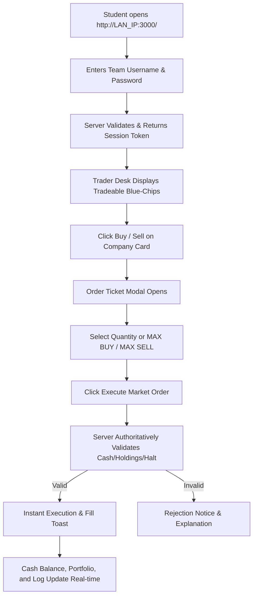

# USER FLOWS & JOURNEYS — THE TRADING FLOOR CHAMPIONSHIP 2026

This document details the end-to-end user journeys for the Competition Host, Student Trader Teams, and the Stage Projector.

---

## 1. Host Journey: Pre-Event Setup & Configuration

1. **Launch**: Organizer double-clicks `Launch_The_Trading_Floor.bat`. The script starts the Node server, detects the LAN IP address (e.g., `192.168.1.45`), and automatically opens `http://localhost:3000/?role=host`.
2. **Curate Market Universe**:
   - Host clicks the **🏛️ Market Builder (Share Universe)** subtab.
   - Host selects an appropriate preset (e.g., Balanced Market) or customizes which stocks are tradeable.
   - Host can optionally click **🎲 Randomize Prices (±10%)** to ensure participants cannot rely on pre-memorized price sheets.
3. **Configure Teams & Roster**:
   - Host clicks **👥 Teams Setup** on the top header.
   - Host selects 4, 8, 12, or 16 teams preset or manually types college team names and student member names.
   - Host clicks **Export CSV** to print team credential slips (Username / Password).
4. **Configure Rules**:
   - Host clicks **⚙️ Settings** to customize day duration (e.g., 20 mins), starting cash (₹5,00,000), circuit breaker limit (20%), and brokerage fee (e.g., 10 bps).

---

## 2. Trader Team Journey: Registration & Live Execution

1. **Connection**: Students open Chrome or Edge on their laptops and navigate to `http://<HOST_IP>:3000/`.
2. **Authentication**: Students enter their assigned team credentials (e.g. `team1` / `trade100`). The server returns an authenticated session token stored in `sessionStorage`.
3. **Market Analysis**: The team monitors live stock cards showing real-time price ticks, % change from day open, Bezier sparklines, and 52-week fundamental metrics.
4. **Order Placement**:
   - Clicking **Buy** or **Sell** opens the Order Ticket modal.
   - Students enter share quantity or click quick presets (`Max Buy`, `Max Sell`, `+10`, `+50`).
   - The ticket displays live gross value, transaction brokerage fee, and remaining cash preview.
   - Clicking **Execute Order** transmits the order over WebSocket to the server.
5. **Confirmation**: A green toast confirms execution (`BUY 50 RELIANCE filled at ₹2,845.20`). Available cash and positions update instantly.

---

## 3. Host Journey: Live Tournament Operation

1. **Opening Bell**: Host clicks **▶ Resume (3-2-1)**. A synchronized 3-second countdown displays across all team screens and the projector, concluding with institutional open bell chimes.
2. **Managing Halts**: If high volatility triggers a 20% price movement, the stock automatically halts with an alarm sound. Host can inspect the halt on the **📈 Stock Engine & Halts** tab and click **Release Halt** when ready.
3. **Breaking News Injection**:
   - Host navigates to **⚡ News Control Deck**.
   - Host clicks **Trigger** on pre-scheduled shocks (e.g. `TCS Q2 Mega Deal`) or clicks **+ Create Breaking News** to draft a custom market shock with custom target ticker, % delta, and duration.
   - Breaking news flashes on all team terminals with a siren audio cue.
4. **Advancing Rounds**: At the end of Day 1, host clicks **⏭ Next Day**. Day 1 closes, current prices freeze as reference points, and Day 2 begins.

---

## 4. Finale & Post-Event Reporting Journey

1. **Championship Conclusion**: At the end of Day 3, host clicks **🏆 Crown Winners**.
2. **Podium Ceremony**:
   - The synchronized Grand Finale Winner Podium modal launches on all screens with confetti and fanfare.
   - Gold (#1), Silver (#2), and Bronze (#3) teams are displayed with verified total net worth and return %.
3. **Audit Export**: Host navigates to **📥 Reports & CSV Exports** and downloads:
   - `Standings CSV` (Official team marksheet and ranking).
   - `Trades Log CSV` (Timestamped ledger of every transaction).
   - `Audit Log JSON` (Complete institutional audit trail).
