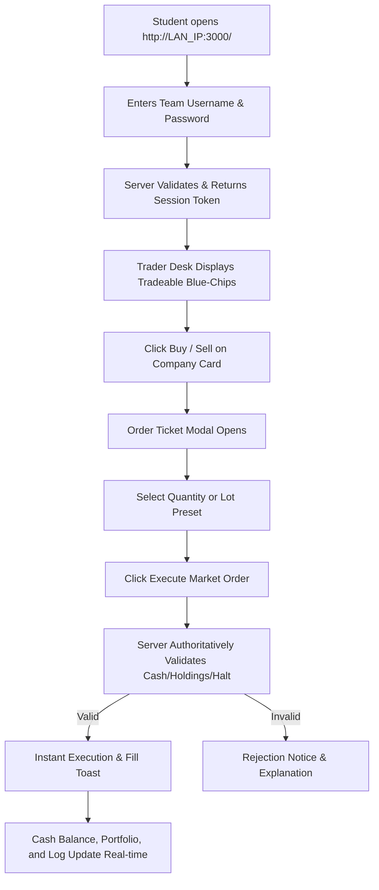

# USER FLOWS & JOURNEYS — THE TRADING FLOOR CHAMPIONSHIP 2026

This document details the end-to-end user journeys for the Competition Host, Student Trader Teams, and the Stage Projector under the **4-Hub Architecture** and **One Action Principle**.

---

## 1. Host Journey: The 4 Canonical Hubs

The Host operates the competition through four primary functional hubs:

```
┌────────────────────────────────────────────────────────────────────────┐
│                        MASTER HOST CONTROL CENTRE                      │
├───────────────┬────────────────┬───────────────────┬───────────────────┤
│   1. HOME     │   2. EVENT     │  3. LIVE MARKET   │ 4. STAGE & RESULTS│
│ Status, Teams │ Setup Wizard,  │ Single Op Bar,    │ Projector Remote, │
│ & Projector   │ Universe, Auto │ Stock Boards, 60s │ Sound Console,    │
│ Monitor       │ News Plan, Lock│ News Privacy      │ Audited Reports   │
└───────────────┴────────────────┴───────────────────┴───────────────────┘
```

### Flow 1: Pre-Event Setup (`⚙️ 2. Event`)
1. **Details**: Set Tournament Title, Starting Cash (default ₹5,00,000), Transaction Brokerage (e.g. 10 bps), and Circuit Breaker Limit (default 20%).
2. **Teams**: Configure active team count (4, 8, 12, or 16), team names, and student rosters.
3. **Companies**: Select participating companies from the real Indian listed universe (`RELIANCE`, `TATAMOTORS`, `TCS`, `HDFCBANK`, etc.).
4. **Schedule**: Choose Total Days (1, 2, or 3) and Day Duration (e.g., 20 or 30 minutes).
5. **Automatic News Plan**: System automatically selects balanced, neutral multi-day storylines strictly for the chosen companies.
6. **Review & Automatic Lock**: All parameters are validated. Once complete, settings transition automatically to **Ready — Locked**:
   > *"Your event setup is complete. Settings are now locked to protect competition fairness."*
7. **Unlock Safeguard**: Host can click **Unlock Configuration** anytime before the tournament starts to make corrections. Once the competition goes live, settings are permanently frozen.

### Flow 2: Live Floor Operations (`📈 3. Live Market`)
1. **Canonical Operations Bar**: Single authoritative control point:
   - `▶ Resume 3-2-1`: Dispatches authoritative server countdown.
   - `⏸ Pause`: Pauses trading across all connected desks.
   - `🕶️ Blackout`: Suspends trading and blinds live price screens.
   - `🏁 Conclude Session`: Concludes current day / tournament.
2. **News Secrecy & 60-Second Reveal**:
   - Private impact percentages are masked by default (`[🔒 Private Price Impact Details Hidden]`).
   - Clicking `👁️ Reveal Private News Details` activates a visible 60-second countdown banner (`⚠️ Private event information is visible. It will hide automatically in 60s.`).
   - Automatically re-masks all private details when the timer expires or when leaving the Market tab.

### Flow 3: Presentation & Reset (`🖥️ 4. Stage & Results`)
1. **Auditorium Projector Remote**: Toggle between `AUTO_CYCLE` playlist and `FIXED_SCREEN` modes.
2. **Venue Sound System**: Remote channel volumes and 1-click audio self-test.
3. **Official Results & Exports**: Download audited Standings CSV, Trades CSV, and Universe JSON.
4. **Safe Championship Reset**: Protected card requiring explicit `"RESET CHAMPIONSHIP"` phrase. Upon execution, all connected trader screens receive a full-screen notification and are returned to the login screen.

---

## 2. Trader Team Journey: Registration & Live Execution



1. **Connection**: Students open Chrome or Edge on their laptops and navigate to `http://<HOST_IP>:3000/`.
2. **Authentication**: Students enter their assigned team credentials (e.g. `team1` / `trade100`).
3. **Trading Desk**: Shows live prices, sparklines, lot presets, and positions.
4. **Non-Blocking Breaking News Wires**: Breaking news appears in a non-intrusive floating top banner without blocking order inputs.
5. **Reset Notice**: If the host executes a tournament reset, traders see a full-screen notification:
   > *"The host has reset the competition. You have been logged out. Please wait for the host to set up a new event."*

---

## 3. Auditorium Projector Journey: Live Stage Multi-Scene Cycle

1. **Projector Launch**: Connected stage laptop navigates to `http://<HOST_IP>:3000/?role=projector`.
2. **Multi-Scene Playlist**:
   - `SCENE_MARKET_BOARD`: 20 live stock cards with sparklines.
   - `SCENE_INDICES`: Real market benchmark indices (`NIFTY_TF20`, `BANK_TF`, `IT_TF`, etc.).
   - `SCENE_STRATEGY`: Macro sector strategy breakdown.
   - `SCENE_LEADERBOARD`: Complete live standings table.
   - `SCENE_NEWS`: Breaking journalistic wire archives.
3. **Grand Finale Ceremony**: When the host initiates winner reveal, smoothly transitions into full-screen awards ceremony (`SCENE_INTRO` -> `SCENE_BRONZE` -> `SCENE_SILVER` -> `SCENE_CHAMPION` with confetti -> `SCENE_PODIUM`).
